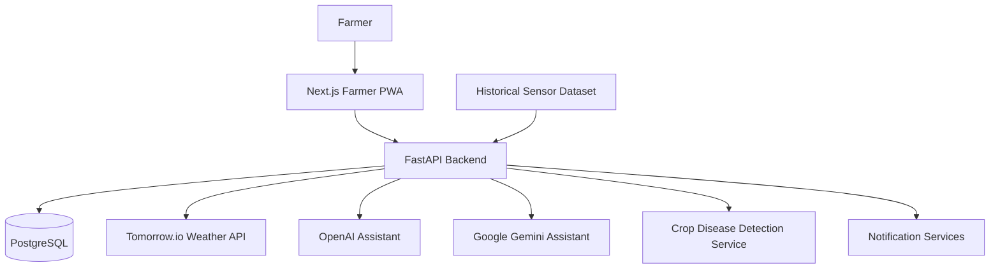

AI-Powered Smart Irrigation System for Predictive Water Management and Crop Optimization
JalSaathi is a farmer-focused smart irrigation platform designed to
support better water management and crop care. It brings together a
mobile-first Progressive Web App (PWA), a FastAPI backend, PostgreSQL,
weather integration, farmer and field management, AI assistants, crop
disease support, and notification features.

The project is being developed to make useful agricultural information
easier to access, especially for smallholder farmers who may have
limited access to desktop computers or English-only tools.
Project status: This repository contains the integrated JalSaathi
application and its current milestone features. Some capabilities
described in the original project scope, such as live farmer-owned
sensor ingestion and production-ready irrigation recommendations, are
not yet connected. The current limitations are listed below so users
can distinguish working features from planned work.

Table of contents
- 1. Project overview
- 2. Problem statement
- 3. Project objectives
- 4. Key features
- 5. Technology stack
- 6. System architecture
- 7. Project structure
- 8. Prerequisites
- 9. Configuration
- 10. Run the application with
  Docker
- 11. Application URLs
- 12. Main application areas
- 13. AI and machine learning
  components
- 14. Notification system
- 15. Multilingual support
- 16. API overview
- 17. Database and data handling
- 18. Run tests
- 19. Security notes
- 20. Current limitations and development
  status
- 21. Planned improvements
- 22. Contributors
- 23. License
1. Project overview
JalSaathi is an integrated smart irrigation application with a
farmer-facing PWA and a backend service. The application is intended to
help farmers manage their farms, review weather information, understand
available field data, receive alerts, and access AI-assisted
agricultural information.

The PWA approach allows the farmer interface to run in a supported
mobile browser without requiring installation through an app store. The
interface is designed for mobile use and supports six languages.

The current application includes farmer accounts, field and crop
management, irrigation scheduling screens, weather integration, chart
assistance, crop disease service integration, and configurable
notification preferences.
2. Problem statement
Farmers can overuse or underuse water when they do not have timely
information about field conditions, weather, crop requirements, and
previous irrigation activity. This can waste water and affect crop
health.

Many digital agriculture tools also assume access to a desktop computer
and familiarity with English. This can make them difficult for
smallholder farmers to use.

JalSaathi aims to make farm information and agricultural assistance more
accessible through a mobile-first interface, regional language support,
weather information, alerts, and AI-assisted features.
3. Project objectives
- Provide a mobile-first application for farmers.
- Allow authenticated farmers to manage their fields and crops.
- Present weather information using an external weather provider.
- Provide irrigation scheduling and related field information.
- Make agricultural information easier to access through multilingual
  UI and AI assistance.
- Provide notification preferences and supported alert delivery
  channels.
- Keep farmer records separated by authenticated account ownership.
- Build a foundation for trusted sensor data and validated machine
  learning recommendations.
4. Key features
Farmer account and profile
- Farmer registration and login.
- Authenticated sessions.
- Farmer profile retrieval and updates.
- Server-side password hashing.
- Farmer-specific access to saved records.
Field and crop management
- Add, view, update, and delete farmer-owned fields.
- Manage crop records associated with a farmer's fields.
- Validate crop-to-field ownership.
- Show saved field and crop information in the farmer interface.
Weather information
- Weather integration through Tomorrow.io.
- Hourly and daily forecast support where provider data is available.
- Manual location selection.
- Optional browser location access after the farmer grants permission.
- Cached locality and weather information where applicable.
- Clear handling when provider configuration or weather data is
  unavailable.
Irrigation and field information
- Irrigation schedule interface and saved schedule information.
- Field and crop context for supported application screens.
- Historical sensor data endpoint for bounded historical records.
- Clear distinction between planned irrigation values and measured
  water usage.
Important: The current repository does not yet provide a live,
trusted farmer-owned sensor ingestion pipeline or a production-ready
irrigation recommendation engine. See Current limitations and
development status.
AI assistants
- Dedicated JalSaathi AI / Chart Assistant experience.
- Persistent farmer-owned conversation history for the Gemini-powered
  dedicated assistant.
- Non-persistent assistant requests for supported chart questions.
- OpenAI-powered educational assistant option in the Experimental
  Model Lab.
- Server-side provider configuration so API keys are not sent to the
  browser.
- Assistant context is restricted to supported farmer-owned
  information.
- Voice input through the browser speech recognition interface where
  supported.
AI-generated explanations do not replace validated model outputs or
professional agricultural advice. The application does not directly
control irrigation equipment.
Crop disease assistance
- Leaf image submission to the separately configured crop disease
  service.
- JPEG, PNG, and WebP image support, with a 10 MB upload limit.
- The application sends the validated disease result and supported
  farmer context to the assistant for explanation.
- Uploaded image bytes are not saved by the application.
Alerts and notification preferences
The Account Settings area supports independent preferences for the four
currently supported channels:
1. In-app notifications
2. Browser Push
3. Email
4. SMS
Notification delivery depends on the required configuration and
subscription or contact details. Browser Push requires an active
subscription. SMS requires a verified phone number. In-app notification
preferences are stored and enforced by the backend.
Progressive Web App
- Mobile-first farmer interface.
- Installable PWA experience in supported browsers.
- Web app icons and service worker support.
- Responsive screens for mobile and larger displays.
- English, Telugu, Hindi, Kannada, Tamil, and Malayalam interface
  translations.
5. Technology stack
  Area                       Technologies
  Farmer application         Next.js, React, JavaScript / TypeScript
Backend API                Python, FastAPI
Database                   PostgreSQL
ORM and database access    SQLAlchemy
Containers                 Docker, Docker Compose
Weather                    Tomorrow.io
AI assistants              OpenAI API, Google Gemini
Crop disease integration   Separate crop disease detection service
PWA                        Web app manifest, service worker, browser installation support
Localization               Shared localization resources for six languages
Testing                    Pytest, Node.js test runner
Large model files          Git LFS

The exact dependencies and versions are maintained in the repository's
dependency and package files.
6. System architecture
The application is organized around a farmer-facing PWA, a FastAPI
backend, and PostgreSQL.

The diagram shows the main application integrations. It does not imply
that live farmer-owned sensor ingestion or production irrigation
recommendations are currently active.
7. Project structure
The repository contains the following main areas. Some supporting
folders and files are omitted here for readability.
JalSaathi-M3-Integration/
├── alerts/                  # Alert rules, database access and delivery logic
├── farmer-pwa/              # Next.js farmer Progressive Web App
├── migrations/              # Reviewed SQL database migrations
├── model4/                  # Crop stress model artifact
├── models/                  # Application model integrations
├── sensor-ingestion/        # Sensor ingestion service and related code
├── static/                  # Legacy frontend assets, scripts and translations
├── templates/               # Backend-served HTML templates
├── tests/                   # Python tests
├── tests_js/                # JavaScript tests
├── weather_api/             # Weather integration
├── compose.yaml             # Base Docker Compose configuration
├── compose.m3-test.yaml     # Milestone 3 test/development overrides
├── main.py                  # Main FastAPI application
├── models.py                # Database models
├── schemas.py               # API schemas
├── requirements.txt         # Python dependencies
└── README.md
8. Prerequisites
Install the following before running the project:
- Git
- Git LFS
- Docker Desktop with Docker Compose
- A supported web browser
- Internet access for downloading dependencies and accessing
  configured external services
For development outside Docker, also install:
- Python version supported by the project dependencies
- Node.js and npm
9. Configuration
Create the local environment file
If this is a new installation, copy the example environment file:
Copy-Item .env.example .env
Open .env locally and set the required values. Do not commit this file
or share its secret values.

Common configuration variables include:
  Variable                            Purpose
  DB_PASSWORD                       PostgreSQL password

  TOMORROW_API_KEY                  Enables provider weather data

  WEATHER_LOCATION                  Optional fallback weather location

  OPENAI_API_KEY                    Enables the OpenAI assistant

  OPENAI_MODEL                      Optional OpenAI model name

  GEMINI_API_KEY                    Enables the dedicated Gemini
assistant

  GEMINI_API_KEY_BACKUP             Optional backup Gemini key

  GEMINI_MODEL                      Gemini model name

  CROP_DISEASE_API_URL              URL for the crop disease service

  APP_ENV                           Application environment
COOKIE_SECURE                     Secure-cookie setting when TLS is
terminated before the app
Set only the values needed for the features you intend to use. Keep all
API keys and passwords on the server.

Existing database warning: If you already have a PostgreSQL data
volume, retain its existing database password. Do not replace it
casually and do not remove the volume to solve a password or startup
problem.
10. Run the application with Docker
The following commands use both Compose files and a separate project
name for the Milestone 3 integration setup.

Run them from the repository root in PowerShell.
Step 1. Check Docker
docker version
docker compose version
Make sure Docker Desktop is running.
Step 2. Check the merged Compose configuration
docker compose -p jalsaathi_m3_test -f compose.yaml -f compose.m3-test.yaml config
This checks the combined configuration without starting containers.
Step 3. Build and start the services
docker compose -p jalsaathi_m3_test -f compose.yaml -f compose.m3-test.yaml up -d --build
Step 4. Check service status
docker compose -p jalsaathi_m3_test -f compose.yaml -f compose.m3-test.yaml ps
Step 5. View logs
docker compose -p jalsaathi_m3_test -f compose.yaml -f compose.m3-test.yaml logs --tail 100
To view logs for one service, replace <service> with the service name:
docker compose -p jalsaathi_m3_test -f compose.yaml -f compose.m3-test.yaml logs --tail 100 <service>
Stop the services
docker compose -p jalsaathi_m3_test -f compose.yaml -f compose.m3-test.yaml stop
To start them again:
docker compose -p jalsaathi_m3_test -f compose.yaml -f compose.m3-test.yaml start
To retain database data, do not use docker compose down -v. The
PostgreSQL data is stored in a named volume.
11. Application URLs
For the Milestone 3 Compose configuration:

  Service                    Local address
  Farmer PWA                 http://localhost:8000/
Main FastAPI backend       http://localhost:8001/
Backend health check       http://localhost:8001/health
PostgreSQL                 localhost:5434
Sensor ingestion service   http://localhost:8003/

The actual published ports are defined by the merged Compose
configuration. If you change the Compose files, check the output of the
config command before using these addresses.
12. Main application areas
The application includes farmer-facing and supporting areas such as:
- Dashboard
- My Fields
- Crops
- Field Monitoring
- Irrigation Schedule
- Reports
- Alerts
- Weather
- Field Predictions
- AI Model Predictions
- Account Settings
- Dedicated AI / Chart Assistant
The screens and available actions depend on the current backend
configuration, stored farmer data, and enabled integrations.
13. AI and machine learning components
The project scope includes machine learning for water management and
crop optimization. The repository also contains model-related
integrations and artifacts. Their current availability must be
understood separately from the original project goals.
Model 2: Water requirement prediction
The intended purpose is to estimate the amount of water required by a
field or crop.

The current production endpoint remains unavailable with HTTP 503. The
repository does not yet contain an eligible production model bundle with
verified labels and trusted prediction-time inputs. Existing synthetic
targets are not treated as measured water requirements.
Model 3: Future soil moisture prediction
Model 3 is part of the project's soil moisture prediction work.
Predictions must be interpreted using the model's actual evaluation and
data provenance. A prediction should not be treated as a verified field
measurement.
Model 4: Crop stress prediction
The project includes a crop stress model artifact. The artifact is
optional at startup. The prediction endpoint returns HTTP 503 when the
required artifact is not available at the path expected by the backend.

A model artifact and its evaluation files are also documented here:

Download Model 4 artifacts from Google
Drive

The ZIP is documented as containing:
- model4_crop_stress.joblib
- evaluation_metrics.json
- feature_importance.csv
- model_comparison.csv
Follow the artifact placement instructions in the current model
integration before running predictions. Do not assume that the presence
of a model file alone makes the endpoint production-ready.
Irrigation optimizer
The milestone irrigation planner exposes:
POST /api/irrigation/plan
It requires IRRIGATION_API_KEY, supplied through the
X-Irrigation-Key request header. It uses the project weather adapter
and returns an explicit error when required weather configuration or
provider data is unavailable.
14. Notification system
The Account Settings page provides independent notification preferences
for:
- In-app notifications
- Browser Push
- Email
- SMS
The backend applies the saved preferences when handling supported alert
delivery. Browser Push requires a valid active subscription. SMS
requires a verified phone number. Email and other external delivery
channels also depend on their server-side provider configuration.

Do not assume that an external provider is configured simply because its
preference appears in the interface.
15. Multilingual support
The application interface supports:
- English
- Telugu
- Hindi
- Kannada
- Tamil
- Malayalam
Legacy pages use:
static/i18n/{en,te,hi,kn,ta,ml}.js
The Next.js PWA uses:
farmer-pwa/locales/{en,te,hi,kn,ta,ml}.json
PWA-specific phrases are maintained in:
farmer-pwa/locales/pwa.json
New user-interface text should have reviewed translations in all six
languages. Do not rely on an English fallback or unreviewed automatic
translation for fixed interface labels.

The original project proposal describes Sarvam AI for Indic-language
voice and dynamic translation. The current implementation should not be
described as having a completed Sarvam AI integration unless that
integration is present and configured in the code.
16. API overview
The following are examples of documented application routes. Refer to
the FastAPI application and its generated API documentation for the
complete current schema.
  Method                  Endpoint                 Purpose
  POST                  /api/auth/register     Register a farmer

  POST                  /api/auth/login        Sign in

  GET                   /api/auth/me           Get the signed-in
farmer profile

  PATCH                 /api/auth/me           Update the farmer
profile

  POST                  /api/auth/logout       Sign out

  GET, POST           /api/fields            List or create
farmer-owned fields

  GET, PATCH,         /api/fields/{id}       Read, update, or delete
DELETE                                         a field

  GET, POST           /api/crops             List or create crop
records

  POST                  /api/assistant/chat    Send a supported
assistant request

  POST                  /api/assistant/image   Submit a leaf image for
crop disease assistance

  GET                   /sensor-readings       Read bounded historical
sensor records
POST                  /api/irrigation/plan   Request a milestone
irrigation plan
For local interactive API documentation, open the FastAPI Swagger UI if
it is enabled by the current application configuration:
http://localhost:8001/docs
Mutating authenticated routes require the application's session and CSRF
protections.
17. Database and data handling
PostgreSQL stores application data such as farmer accounts, sessions,
fields, crops, and assistant conversations.

The application uses additive database setup for supported missing
tables. This setup does not drop or rewrite existing tables. Future
schema changes should use reviewed migrations.

Important data distinctions:
- Historical sensor_readings records are not automatically treated
  as live farmer telemetry.
- Farmer-linked sensor records use a separate ownership-constrained
  table.
- Dataset field identifiers are not assumed to identify a farmer's
  saved fields.
- Irrigation schedule volumes are planned values, not measured water
  consumption.
- Synthetic or derived data must not be presented as verified field
  measurements.
The documented farmer sensor migration is:
migrations/001_add_farmer_sensor_readings.sql
Review and apply migrations to the intended database according to the
migration instructions. Do not assume every SQL file is applied
automatically.
18. Run tests
Python tests
Install development dependencies:
python -m pip install -r requirements-dev.txt
Run the Python test suite:
python -m pytest tests weather_api/integrations/test_cache.py
JavaScript syntax checks
node --check static/auth.js
node --check static/app.js
node --check static/sections.js
node --check static/weather.js
node --check static/landing.js
node --check static/field-store.js
node --check static/profile-store.js
node --check static/i18n.js
node --check static/farmer-assistant.js
JavaScript tests
node --test tests_js/*.test.cjs tests/test_weather_frontend.cjs
PWA localization checks
Run from the PWA directory:
cd farmer-pwa
npm install
npm run test:i18n
The localization gate checks translation resources and visible interface
text.
19. Security notes
- Never commit .env or real API keys.
- Keep provider credentials on the backend.
- Passwords are hashed using Argon2id.
- The browser receives an HttpOnly session cookie.
- PostgreSQL stores a SHA-256 digest of the session token.
- Mutating requests require a CSRF token.
- Cross-origin unsafe requests are rejected.
- Farmer field and crop routes enforce authenticated ownership.
- Uploaded crop images are not persisted by the application.
- Use HTTPS in production.
- Apply shared rate limiting at a trusted gateway when running
  multiple backend workers or replicas.
20. Current limitations and development status
The following points are important when evaluating the current
application:
1. Historical sensor readings may contain synthetic or
   synthetic-augmented data. They are not live sensor telemetry.
2. A live farmer-owned sensor ingestion endpoint is not yet included
   for the farmer sensor table.
3. Soil history for a farmer remains unavailable until trusted,
   correctly owned readings are supplied.
4. A production irrigation recommendation engine is not yet connected.
5. Model 2 water requirement prediction remains unavailable with HTTP
   503 until eligible training labels and trusted prediction-time
   inputs are collected and validated.
6. Model 4 prediction requires its model artifact to be available at
   the backend's configured path.
7. Irrigation schedule volumes are planned values, not measured water
   consumption.
8. Weather and AI features require their corresponding provider
   credentials.
9. Notification delivery depends on valid subscriptions, verified
   contact details, and provider configuration.
10. The original project proposal mentions Sarvam AI, MQTT, InfluxDB or
    TimescaleDB, MLflow, Twilio, and SendGrid. These should be
    considered proposed technologies unless their integrations are
    confirmed in the current code.
11. The AI assistant is informational. It does not control irrigation
    equipment or create verified model predictions.
21. Planned improvements
The original project scope identifies the following areas for further
development:
- Trusted live sensor ingestion through MQTT or REST APIs.
- Reliable farmer-owned sensor history and time-series storage.
- A validated irrigation scheduling engine using trusted field data.
- Further evaluation of Random Forest, Gradient Boosting, and LSTM
  models.
- Model versioning and experiment tracking.
- More complete field-level drought, over-watering, and sensor-failure
  alerts.
- Further voice-based regional language assistance.
- More end-to-end, load, and low-bandwidth testing.
- Additional deployment automation and CI/CD.
- More complete technical documentation, evaluation reports, and
  demonstration material.
These are development goals, not claims that every item is already
available.
22. Contributors
This project was developed as part of the Springboard Internship 2026
project work.

Add the confirmed team member names, roles, and profile links here
before publishing the final repository documentation.
23. License
Add the project's approved license here. Until a license is added to the
repository, do not assume that the code is open source or available for
unrestricted reuse.
Additional documentation
- [Application health report](reports/APPLICATION_HEALTH_REPORT.md)
- [Model 2 evidence and collection
  plan](model-building/reports/model2_water_requirement_report.md)
For setup issues, check the Docker Compose configuration, environment
variables, service logs, and the relevant feature's provider
configuration before changing or deleting database data.
